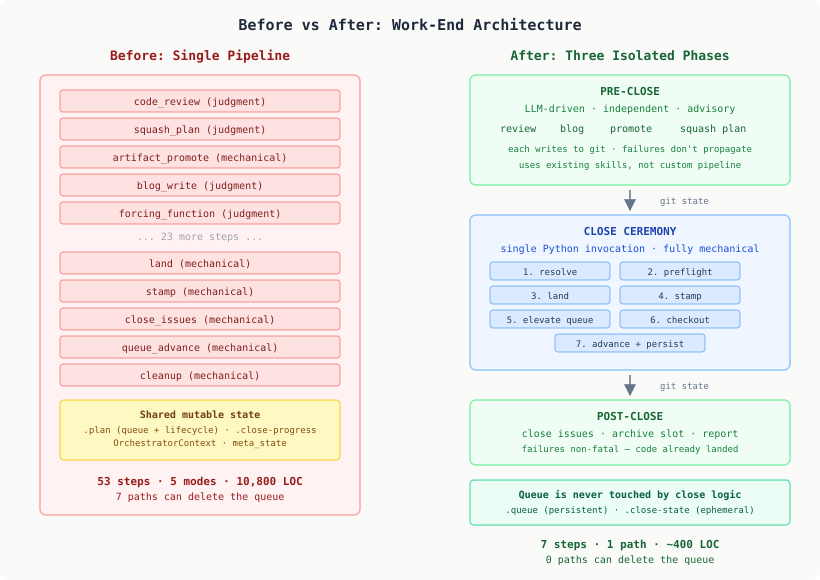

# Eighty Bugs in Seventy Days

The work-end orchestrator has been accumulating issues at the rate of more than one per day since August. Eighty issues in seventy days — plan destruction, orchestrator loops, state incoherence, multi-repo coordination failures, each fixed and each replaced by a new variant of the same structural problem. Today we stopped patching.

This is the fifth entry in the work-end arc. The first four tell the story of how we got here: [building the state machine](2026-08-03-mdp02-the-state-machine-that-replaced-six-if-statements.md), [merging two plans into one file](2026-08-17-mdp01-two-plans-one-file.md), [wiring the orchestrator](2026-08-25-mdp01-wiring-the-orchestrator.md), and [watching it get stuck](2026-09-14-mdp01-orchestrator-mechanical-failures.md). Each entry solved real problems. Each one also added complexity that made the next class of problem harder to diagnose.

## The diagnosis

A deep read of the system — 10,800 lines across 58 files — produced five structural root causes. Not five bugs. Five architectural properties that make bugs inevitable.

**The dual-purpose file.** The `.plan` file is simultaneously an issue queue (what to work on next) and a lifecycle state container (which closing step we're on). Seven independent code paths can delete it. Only three of those check whether the queue has remaining items. Every plan-wipe bug — and there have been twelve — is this coupling. Deleting ceremony state destroys the queue. ADR-0013 merged `.meta` into `.plan` for "one file, no sync." The tradeoff was invisible at the time: coupling two things with fundamentally different lifecycles.

**The combinatorial pipeline.** Fifty-three steps filtered by five modes (BRANCH, SLOT, MAIN, SYNC, CYCLE) and five repo dispositions (HAS_WORK, NO_BRANCH, EMPTY_BRANCH, ALREADY_LANDED, DIFFERENT_BRANCH). That is 1,325 theoretical execution paths. Each bug fix touches one path. Each fix can break others silently, because no test covers the mode × disposition matrix.

**Scattered state.** Four places track "where are we": `.close-progress` (step completion), `.plan state:` (lifecycle state), git branch HEAD (actual branch position), and the LLM's in-context `meta_state` variable. No consistency protocol. No transaction boundary. The window between reading from one and writing to another is where the state incoherence bugs live.

**Bolt-on multi-repo.** The `OrchestratorContext` has singular `project` and `workspace` fields. Multi-repo is handled by mutating `ctx.current_repo_project` during a loop iteration, then resetting it. Every step must use the `getattr(ctx, "current_repo_project", None) or ctx.project` pattern. Miss one instance and that step silently operates on the wrong repo. Fourteen multi-repo bugs trace to this.

**Recovery that creates failure.** The reconciliation engine resets progress when evidence checks fail. The phase-skip logic fills gaps based on lifecycle state. The lifecycle transition can fail on concurrent modification. Each recovery mechanism can leave the system in a state that triggers a different recovery mechanism. Thirteen loop and stall bugs came from the system designed to prevent them.

## The pattern that should have been a signal

Categorising eighty issues produces this:

| Category | Count |
|----------|-------|
| Plan destruction / clobbering | 12 |
| Orchestrator loops / stalls | 13 |
| Checkout / state confusion | 16 |
| Multi-repo coordination | 14 |
| Issue closure | 5 |
| Other (features, cleanup) | 20 |

The plan destruction column is the one that matters most, because it is the same bug. Not the same code, not the same function — the same structural failure, expressing itself in a new code path each time we guard the previous one. Issue #358 in September: `work-end strips .plan unconditionally`. Issue #485 in November: `delete_progress unconditionally removes .plan with remaining items`. Issue #496, the same day: `elevate_plan clobbers slot-level queue`. Issue #498, still open: `work-end deletes .plan file, wiping remaining queue items`.

When the fix rate exceeds one per day and the same category keeps recurring, the architecture is the bug.

## The redesign

Six decisions, each derived from a specific root cause:

1. **Strip to essentials.** Work-end owns only: land content, stamp branch, advance queue, checkout main. Everything else — review, blog, artifact promotion, issue closure — becomes a pre-close or post-close concern that runs independently. Failure in one cannot corrupt another.

2. **Separate the queue from ceremony state.** The issue queue (`.queue`) persists across many branch close cycles. Close-ceremony state (`.close-state`) is ephemeral — created on ceremony entry, deleted on success. Only one function writes to `.queue` during close. No other code path reads, writes, or deletes it.

3. **One ceremony, different inputs.** The close ceremony is always the same seven steps. What varies is the input: which repos, which branches. Mode resolution happens before the ceremony, not inside it. A slot with three repos produces three targets. A single-repo branch produces one. The ceremony doesn't know or care about the difference.

4. **Fully mechanical execution.** The ceremony runs as a single Python invocation. No LLM loop, no progress file, no reconciliation engine. Each step is idempotent — re-running after a partial failure checks what's already done and continues. The ceremony is short enough that "re-run from scratch" is cheaper than "reconcile partial state."

5. **Eliminate most corruption triage.** The 620-line corruption detector exists because work-end leaves inconsistent state that the next session has to recover from. A system that doesn't leave inconsistent state doesn't need most of that recovery. Seventeen scenarios shrink to four.

6. **Replace the state machine with a status field.** Twelve lifecycle states enforced ordering in an LLM-driven loop where steps could execute in any order. In a sequential mechanical ceremony, the code is the ordering constraint. Four status values — active, paused, drained, idle — replace 776 lines of state machine.

## What makes this work

The key property is failure isolation. The old architecture had one long pipeline where step 17 (blog promotion) could fail and corrupt state that step 42 (queue advance) needed. Every concern shared the same mutable context, the same progress file, the same lifecycle state.

The new architecture has hard boundaries. Pre-close steps write to git. The ceremony reads committed git state — anything not committed before ceremony start is not included. Post-close steps read committed state from after the ceremony. No shared mutable files, no progress tracking between phases, no reconciliation.

Pre-close failures do not corrupt ceremony state. Ceremony failures do not destroy the queue. Post-close failures do not invalidate the landed code.

The net effect: 10,800 lines become ~400. Fifty-three pipeline steps become seven. Five modes become one. Twelve lifecycle states become four status values. Seven paths that could delete the queue become zero.

## When to stop patching

The practical lesson is about recognising when you're in a patch cycle. The signals:

**Fix rate outpaces new development.** When more than half the commits on a component are fixes to fixes, the component is generating work, not absorbing it.

**The same category recurs.** Not the same bug — the same structural failure in a new location. Guards on individual code paths don't help when seven paths exist and new ones get added without the guard.

**Recovery code is the bug source.** When the system built to handle failures is itself the primary source of failures, the recovery model is wrong. Our reconciliation engine produced thirteen loop bugs.

**Mode count grows monotonically.** Five modes with five dispositions is a 25-cell matrix. No team maintains exhaustive tests for 25 interaction patterns. Every new mode multiplies the existing ones.

The decision to redesign is never obvious from inside the fix cycle. Each individual fix is reasonable. Each passes its tests. The system just keeps breaking somewhere else. The metric that finally made the decision clear was the most basic one: eighty issues in seventy days. More than one per day, for over two months.

The implementation is underway. Batch 1 — the queue I/O module with transparent `.plan` migration — landed with 16 tests. Batch 2 — the ceremony itself — followed with 24 more: resolve, preflight, land, stamp, advance, and the orchestration that ties them together. The ceremony's ~400 lines do what 10,800 used to. One detail surfaced during implementation: writing `.close-state` before `preflight()` makes the workspace dirty, which then fails preflight's own dirty-worktree check. Moving the state file write to after preflight — a small reordering, but the kind of thing you only catch by building it. Three batches remain: consumer migration, switchover, and deletion of the old code.
